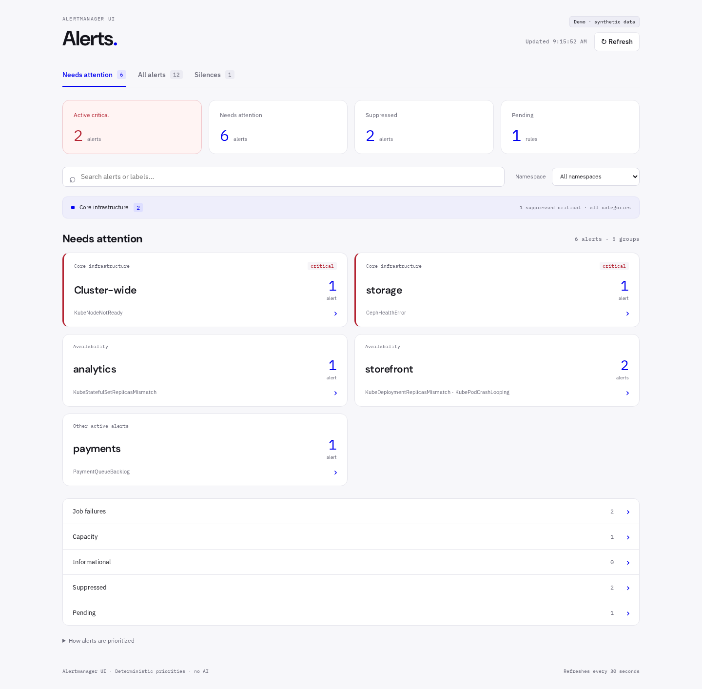
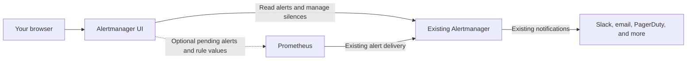
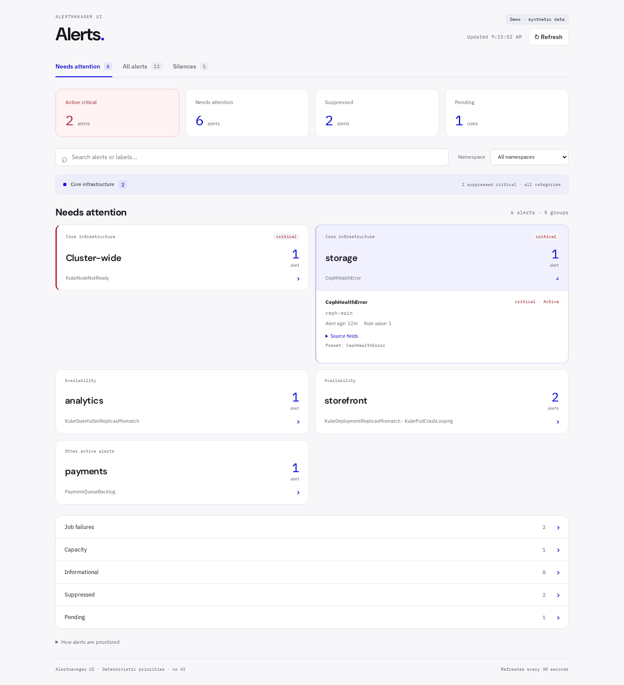
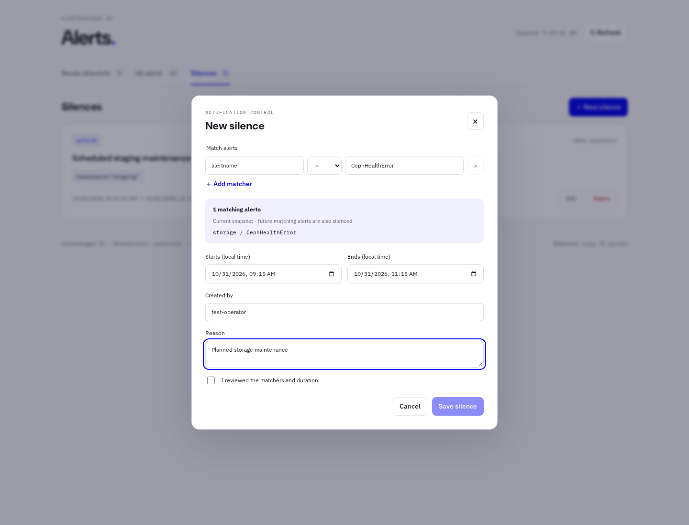
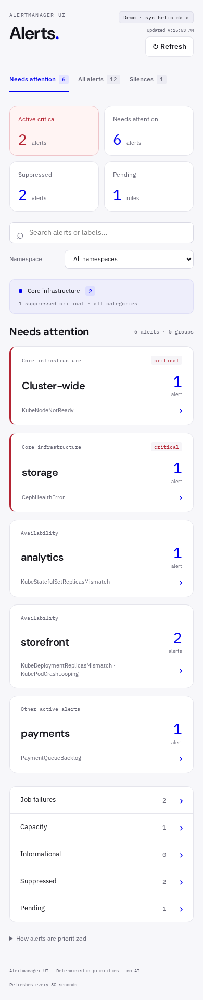

<div align="center">

# Alertmanager UI

### See the alerts that matter.

A focused, open-source interface for Prometheus Alertmanager.<br>
Put infrastructure failures first. Keep routine signals out of the way.<br>
Keep your existing alerting setup.

[](https://github.com/aai-labs/aai-alertmanager-ui/actions/workflows/ci.yml)
[](LICENSE)
[](https://github.com/aai-labs/aai-alertmanager-ui/releases)
[](https://github.com/aai-labs/aai-alertmanager-ui/pkgs/container/aai-alertmanager-ui)
[](docs/compatibility.md)

[Quick start](#quick-start) · [How it works](#how-it-works) · [Installation](docs/installation.md) · [Configuration](docs/configuration.md) · [Contributing](CONTRIBUTING.md)

</div>



*Actual application, synthetic data. No production alerts or tenant information appear in these screenshots.*

## Your alert list should help you decide where to look

A failing storage layer, a crashing application, and a silenced staging alert should not demand the same attention. Alertmanager already knows an alert's labels, severity, and suppression state. This UI turns those signals into a focused view you can inspect and tune.

- **Important alerts first.** Active critical alerts, recognized infrastructure failures, and availability alerts stay in view. Unfamiliar alerts remain visible, too.
- **Less noise, with nothing lost.** Routine job failures, capacity signals, informational alerts, and suppressed alerts sit in counted, expandable sections. Switch to **All alerts** whenever you need the full picture.
- **A reason for every placement.** Small, explicit rules drive prioritization. Inspect the matching preset or configure your own. No LLM, generated diagnosis, or guessed root cause.
- **Your existing silences.** Preview matching alerts, then create, edit, or expire silences in Alertmanager. Read-only mode is one setting away.
- **One container. One upstream URL.** No database, agents, CRDs, or Kubernetes permissions. Prometheus and a configuration file are optional.
- **Optional tenant access.** Connect your authentication proxy and grant namespaces to users or groups. The server enforces access; tenants remain read-only.

## Quick start

### GitHub Container Registry

The official image is **`ghcr.io/aai-labs/aai-alertmanager-ui:v0.1.0`**. The Helm chart is **`oci://ghcr.io/aai-labs/charts/aai-alertmanager-ui`**, version `0.1.0`.

[Container package](https://github.com/orgs/aai-labs/packages/container/package/aai-alertmanager-ui) · [Helm package](https://github.com/orgs/aai-labs/packages/container/package/charts%2Faai-alertmanager-ui)

Both packages are public. No GitHub account or registry login is required to download them.

```bash
# Try the interface with fictional alerts. No cluster connection needed.
docker run --rm -p 127.0.0.1:8080:8080 \
  -e DEMO=true ghcr.io/aai-labs/aai-alertmanager-ui:v0.1.0
```

Open **[localhost:8080](http://localhost:8080)**.

To connect an existing Alertmanager on a Docker network:

```bash
docker run --rm -p 127.0.0.1:8080:8080 \
  --network monitoring \
  -e ALERTMANAGER_URL=http://alertmanager:9093 \
  ghcr.io/aai-labs/aai-alertmanager-ui:v0.1.0
```

Use your actual network and an Alertmanager address reachable from the container. For a public installation, reuse your authenticated reverse proxy and HTTPS. The default mode trusts every visitor as an operator; it does not add a login system.

**Running Kubernetes?** Install the published Helm chart:

```bash
helm upgrade --install alerts oci://ghcr.io/aai-labs/charts/aai-alertmanager-ui \
  --version 0.1.0 --namespace monitoring \
  --set alertmanager.url=http://YOUR_ALERTMANAGER_SERVICE.monitoring.svc:9093
```

Use an existing namespace. Images support Linux **amd64 and arm64**. Standalone Linux/macOS binaries are available in [Releases](https://github.com/aai-labs/aai-alertmanager-ui/releases). To build from source, see [Contributing](CONTRIBUTING.md).

See the **[installation guide](docs/installation.md)** for Docker Compose, Helm, standalone binaries, subpaths, authentication, and upgrades.

## How it works



The Go server serves the React interface and talks to your existing APIs. Upstream credentials stay on the server. Alertmanager continues to own routing, inhibition, notifications, and silence storage.

This replaces the **web interface**, not the Alertmanager process or alert-ingestion API. Introduce it alongside the original UI, validate it, and change the user-facing route when you are ready.

### Focus without guesswork

| Signal | Default presentation |
| --- | --- |
| Active critical alert | Prominent, even when its normal category is routine |
| Recognized core infrastructure or availability alert | Needs attention |
| Unfamiliar alert | Needs attention; never hidden by an unknown name |
| Known warning-level job failure or capacity signal | Collapsed section with a count |
| Informational alert | Collapsed informational section |
| Silenced or inhibited alert | Suppressed section; critical core infrastructure stays prominent |
| Pending Prometheus rule | Separate pending section |

Cards group alerts by **namespace and category**. They do not claim several symptoms are one incident. Original names, labels, annotations, severity, and suppression state remain available inside each card.

Zero matching alerts means exactly that. It does not establish that a cluster or storage system is healthy. A source failure is shown explicitly; the interface never reports recovery because it lost its connection.

[See the preset catalog and tuning rules →](docs/prioritization.md)

<details>
<summary><strong>Inspect the source, without leaving the queue</strong></summary>



Original alert data is available on demand. Optional Prometheus enrichment adds current rule values when labels match unambiguously.

</details>

<details>
<summary><strong>Keep silence management in the same place</strong></summary>



The editor is shown against synthetic test data. Connected operators can preview matchers and create, edit, or expire silences, with an explicit confirmation before saving.

</details>

<details>
<summary><strong>Check alerts from a smaller screen</strong></summary>



</details>

## Start simple. Add what you need.

| Capability | Required setup |
| --- | --- |
| Alert browsing, priorities, search, and silences | `ALERTMANAGER_URL` |
| Read-only operator interface | `READ_ONLY=true` |
| Pending alerts and current rule values | `PROMETHEUS_URL` |
| Custom categories and display names | Optional YAML priority rules |
| Namespace-restricted tenants | Trusted authentication proxy and explicit namespace grants |
| Hosting under `/alerts` | `BASE_PATH=/alerts` and a matching proxy route |

Tenant access is enforced on the server. Simply selecting a namespace in operator mode does **not** restrict access. The optional tenant setup also requires preventing direct access to the upstream Alertmanager and Prometheus services.

[Configuration reference →](docs/configuration.md) · [First cluster rollout →](docs/deployment-cluster.md)

## Compatibility and boundaries

The integration suite exercises actual **Alertmanager 0.27.0 and 0.34.1**, including silence changes and subpath hosting. These are tested endpoints of the compatibility matrix, not a claim that every intermediate version has been tested. [Read the compatibility report](docs/compatibility.md).

The first release connects to one Alertmanager and optionally one Prometheus. It has no persistent incident history, automatic remediation, multi-cluster aggregation, or built-in identity provider. Alerts and silences remain owned by the upstream systems.

## Build with us

Useful contributions include portable alert presets, real-world compatibility reports, accessibility improvements, and clearer ways to expose important signals without guessing.

```bash
# Requires Go 1.26 and Node.js 22.12+ with npm.
make build
DEMO=true .build/alertmanager-ui
```

[Development and tests](CONTRIBUTING.md) · [Report a bug](https://github.com/aai-labs/aai-alertmanager-ui/issues) · [Security](SECURITY.md)

## License

[Apache-2.0](LICENSE). Bundled fonts retain their SIL Open Font License notices. See [NOTICE](NOTICE) for attribution.

An independent open-source project. Not affiliated with or endorsed by the Prometheus project.
